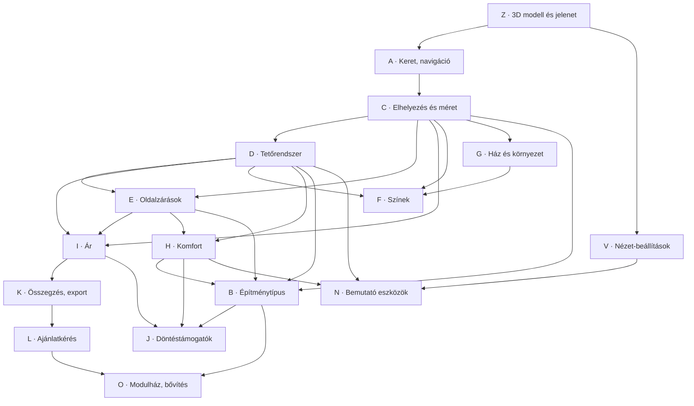

# Lamelix konfigurátor – függőségi térkép

> Állapot: 2026-11-18 · `main` @ `f99acce` (5.03). A funkciókódok a `FEATURE_INVENTORY.md`-re utalnak.

## 1. Az adatfolyam egy mondatban

Minden kezelőelem egyetlen `PergolaConfig` objektumot (a termék) vagy egy `SceneSettings` objektumot (a jelenet) módosít. A `PergoStudio.applyConfig` minden módosítást a gyártói szabályokon (`normalizeConfig`) vezet át, ebből számolódik az ár (`calculatePrice`), és ebből épül a 3D (`PergolaScene`). A kezelőfelület tehát **leválasztható** a modellről: ha egy kezelőelemet elrejtünk, a hozzá tartozó mező az alapértékén marad, és a 3D változatlanul működik.

```
 Kezelőelemek (A–N)                 Állapot (PergoStudio)                     Kimenetek
 ─────────────────────              ─────────────────────────                 ─────────────────────
 Controls, SideAndExtras,  ──patch──▶ applyConfig ─▶ normalizeConfig ─▶ config ─┬─▶ PergolaScene (3D)
 ColorPicker, Building…              (tenants/rules.ts)                         ├─▶ calculatePrice ─▶ ár (I)
                                     history (K05), roofStash (D05),            ├─▶ persistConfig (K08), shareHash (K07)
                                     buildingStash (B02)                        └─▶ PDF/kép/videó (K), lead (L)
 SceneSettingsPanel, eszközök ─patch─▶ updateScene ─▶ scene ──────────────────────▶ PergolaScene (jelenet)
```

## 2. Modulok közötti függőségek



| Modul | Közvetlenül erre épül | Miért |
|---|---|---|
| A Keret | Z | A panel a vászon mellé kerül; a nézet eltolása (`viewShiftX`) a panelszélességtől függ. |
| C Elhelyezés, méret | A | Lépésben jelenik meg. A rögzítés dönti el az oszlopokat, a falat és a házat (G06). |
| D Tető | C | A tető a méretre épül; a tetőfüggő mezőket a `normalizeConfig` a tetőhöz igazítja. |
| E Oldalak | C, D | A falas oldal nem zárható (C01); a fal magassága a dőléstől függ (D04). |
| F Színek | C, D, G | A kéttónusú szín tetőfüggő (F03); az ablakhoz igazítás a házra épül (F05). |
| G Ház, környezet | C | A ház helye a rögzítéstől függ. |
| H Komfort | D, E | A szenzor mozgó tetőt vagy ZIP-et igényel (H06); a ventilátor és a fűtés a tető alá kerül. |
| B Építménytípus | C, D, E, H | Átállítja a tetőt, az oldalakat és a klímát; a szabályai mindegyikre hivatkoznak. |
| I Ár | C, D, E (és minden, ami tétel) | Az ár a teljes konfigurációból számolódik; a logika már kész, csak a felület jön vissza. |
| J Döntéstámogatók | B–I | Teljes konfigurációt javasolnak; csak akkor értelmesek, ha minden mező állítható. |
| K Összegzés, export | I | A PDF, a kép és a szöveg az árat is tartalmazza. |
| L Ajánlatkérés | K, I | Az űrlap az összegzésben van; a szerver újraáraz. |
| V Nézet | Z | Csak a jelenetet állítja. |
| N Bemutató eszközök | V, D, H | A Működés csak lamellás tetőnél (D01), az esti panel a komfortelemeknél (H) értelmes. |
| O Modulház, bővítés | B, L | A modulház a „Mit építesz?” választóból indul; a bővítés a leadhez küld. |

## 3. Közös szolgáltatások (több modul használja)

Ezeket a lecsupaszításkor **nem** rejtjük el, mert nincs saját felületük, de több modul épít rájuk:

| Szolgáltatás | Hol | Kik használják |
|---|---|---|
| `applyConfig` / `updateConfig` / `replaceConfig` | PergoStudio | minden konfig-modul (B–H, J, K) |
| `updateScene` | PergoStudio | G, V, N, D07, E06, H05 |
| `normalizeConfig`, `parseConfig` | `src/tenants/rules.ts` | állapot, link, piszkozat, szerver |
| `calculatePrice` | `src/lib/pricing.ts` | I, J, K, L, szerver |
| Visszavonás (`history`) | PergoStudio | K05, I03 |
| Követő kamera (`reactToChange`, `goStep`, `focusSide`) | PergoStudio | A02, E01, H01, H05, F |
| Értesítés (`toast`) | PergoStudio | szinte minden modul |
| Gyártói adatok (`useTenant`) | `src/tenants/TenantContext.tsx` | minden modul (kínálat, árak, korlátok, márka) |
| Fordítás (`tr`, `localized`) | `src/i18n/locale.ts` | minden felirat (magyar, német) |

## 4. Állapotmezők és tulajdonosuk

| Mező | Modul | Alapérték forrása |
|---|---|---|
| `width`, `depth`, `height`, `modules` | C | `productDefaultConfig` (`src/lib/config.ts`) a gyártói alapértékből |
| `mount` | C | mint fent |
| `roof`, `louverAngle`, `pitch`, `glazing`, `roofShade`, `shadeFabric`, `solar` | D | mint fent |
| `sides`, `split`, `doorMirror`, `screenOpen` | E | mint fent |
| `frameColor`, `customRal`, `roofColor`, `roofRal` | F | mint fent |
| `led`, `ledRgb`, `speakers`, `heaters`, `fans`, `sensors`, `smartHome` | H | mint fent |
| `building`, `wallGlazing`, `climate`, `foundation`, `openSides` | B | mint fent |
| `scene.*` (napszak, környezet, ház, bútor, kapcsolók, eszközök) | G, V, N | `DEFAULT_SCENE` (`src/lib/config.ts`) + `loadHouseLook` |
| `step`, `selectedSide`, `sheet`, `view`, `modal`, `presentation`, `walking` | A, E, V, N | PergoStudio `useState` |

## 5. Kockázatos összefonódások (visszaépítéskor figyelni)

1. **Építménytípus ↔ tető ↔ oldalak.** A veranda/télikert váltás kényszerből átírja a tetőt és az oldalakat, és visszaváltáskor helyreállítja (`buildingStash`). Ha a B modul előbb jön vissza, mint a D és az E, a felhasználó olyan változásokat lát, amelyeket nem tud visszaállítani. Ezért a B a D és az E után jön.
2. **Tetőváltás memóriája** (`roofStash`): a D01 és a D06–D08 együtt működik; a D01 egyedül is működik, de a tetőfüggő mezők rejtve maradnak.
3. **Követő kamera.** A lépésváltás és a módosítások kameramozgást indítanak. Ha a lépésfülek még nincsenek visszaépítve, a kamera nem mozdul (a `goStep` nem hívódik), ez elfogadható.
4. **Kiinduló csomagok és tanácsadó** (B08, J01) a teljes konfigurációt felülírják, rejtett mezőkkel együtt. Csak akkor építhetők vissza, ha minden érintett mező látható.
5. **Esti hangulat panel** (N02): magától nyílik meg éjszakai napszaknál. A lecsupaszított módban ezt is el kell rejteni, különben „magától” megjelenik.
6. **Automatikus esti váltás** (`reactToChange`, LED bekapcsolásakor): kezelőelem nélkül nem fut, de visszaépítéskor újra él.
7. **Mérés** (P01–P03): a lecsupaszított mód is küldene megnyitás-eseményt, ami elrontaná a demó statisztikát. Ki kell kapcsolni.
