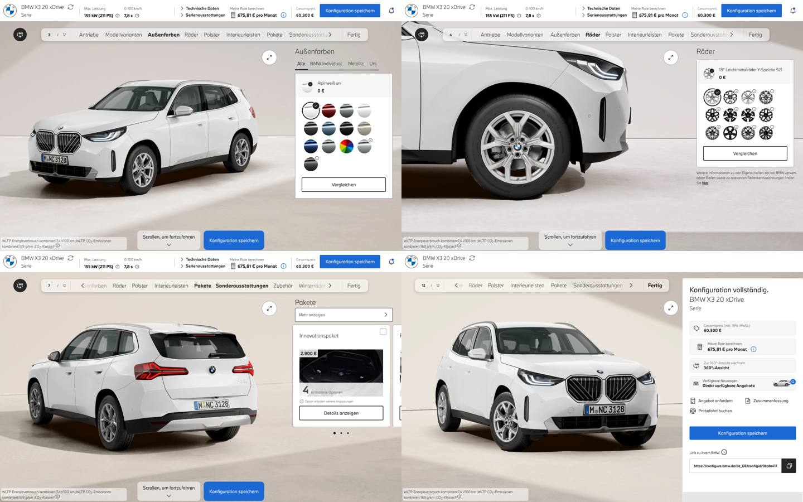
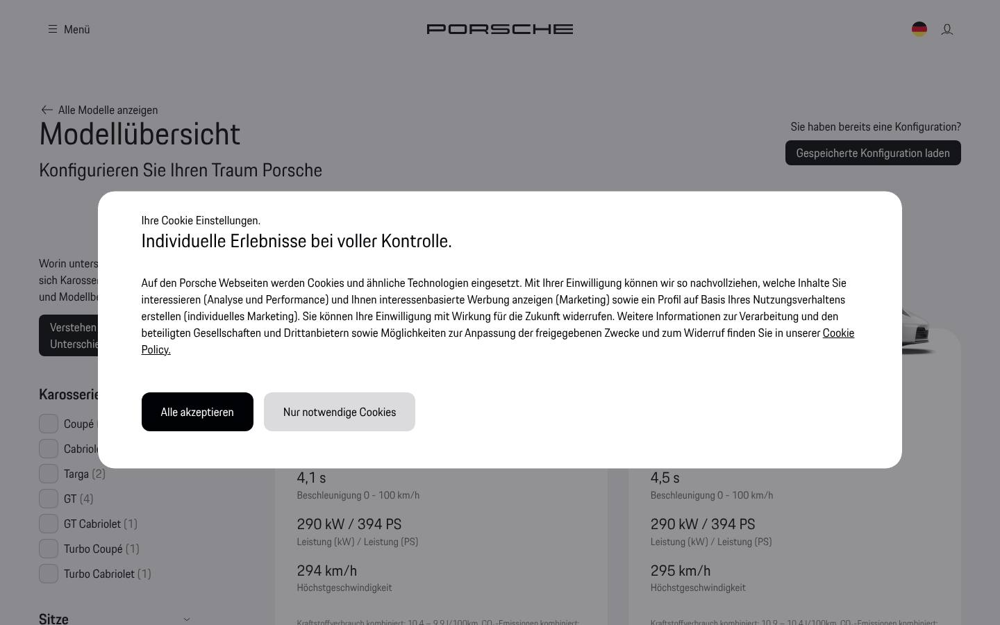
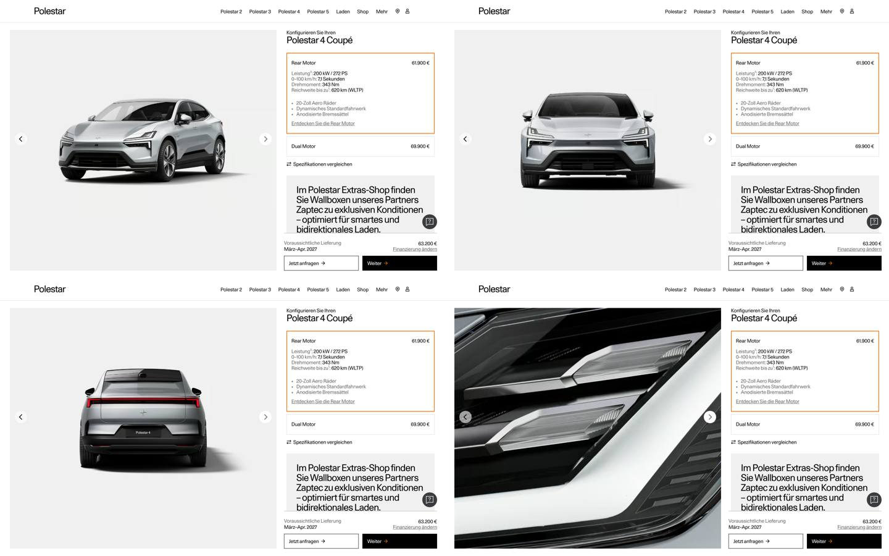
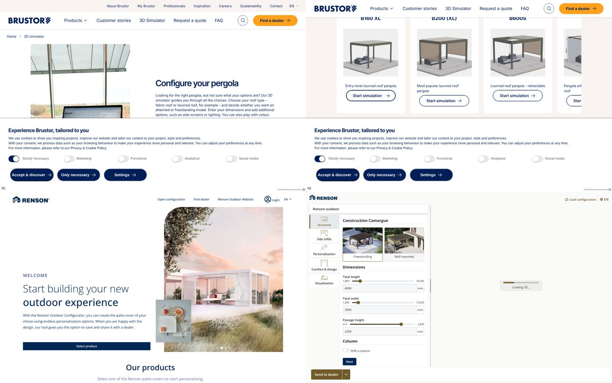

# Referencia-konfigurátorok – hogyan épül fel a kalkulátoruk

Dátum: 2026-11-18 · Cél: alap a teljes képernyős 3D + lebegő üvegpaneles Lamelix-újraépítéshez (D1).
Módszer: élő oldalak végigkattintása Playwrighttal (asztali 1440×900), képernyőkép + oldalszöveg lépésenként, kiegészítve a gyártók nyilvános oldalaival.
Kódmódosítás nincs; ez kutatás, a döntések Ádámé.

## 1. Röviden

1. **Az ár mindig látszik, ha van ár.** Porsche, BMW és Polestar: a teljes ár a lépésektől független, rögzített helyen van (fejléc vagy ragadós alsó sáv), mellette a havi részlet. Opciónként a felár közvetlenül az opción.
2. **A pergolagyártók (Renson, Brustor) nem mutatnak árat**: a terv kereskedőhöz megy, az ad ajánlatot. A SaaS-szolgáltató SaleSqueze ezzel szemben élő árat és azonnali PDF-ajánlatot ad, és az árat a gyártó kapcsolhatja ki.
3. **A BMW a legközelebbi minta a D1-hez**: teljes képernyős vizuál, fölötte lebegő lépéssáv („3 / 12”) és jobbra lebegő tartalomkártya. A Lamelix üvegpaneles iránya ezt követi.
4. **A Renson a legközelebbi szakmai minta**: bal oldali ikonos lépéssáv 5 lépéssel, méretek csúszkával és mm-es mezővel, alul „Send to dealer”.
5. **Az összegzés oldal mindenhol döntési pont**: teljes ár, mentés, megosztható link, ajánlatkérés egy helyen.

## 2. Referenciák egyenként

### BMW (X3) – teljes képernyő + lebegő panelek

- **Elrendezés:** a kép kitölti a képernyőt. Felül lebegő, lekerekített lépéssáv számlálóval („3 / 12”), nyilakkal görgethető: Antriebe → Modellvarianten → Außenfarben → Räder → Polster → Interieurleisten → Pakete → Sonderausstattungen → Zubehör → Winterräder → Fertig.
- **Tartalomkártya:** jobbra lebeg a kép fölött. A kiválasztott opció neve és ára („Alpinweiß uni, 0 €”) a kártya tetején, alatta színminták vagy felnirács, szűrőfülek (Alle / BMW Individual / Metallic / Uni), és „Vergleichen” gomb.
- **Csomagok:** vízszintes kártyakörhinta. Minden kártyán ár (pl. 2 900 €), kép, „4 enthaltene Optionen”, jelölőnégyzet és „Details anzeigen”.
- **Ár:** fehér fejlécsávban, mindig látszik: „Meine Rate berechnen 675,81 € pro Monat” és „Gesamtpreis 60 300 €”, plusz kék „Konfiguration speichern”.
- **Alsó sáv:** „Scrollen, um fortzufahren” és ismét a mentés gomb. Bal alul a kötelező fogyasztási adatok.
- **Záró lépés (Fertig):** jobb oldali panel „Konfiguration vollständig.” Teljes ár (ÁFA-val), havi részlet, 360°-nézet, elérhető készletautók, „Angebot anfordern”, „Zusammenfassung”, „Probefahrt buchen”, mentés, és a konfiguráció másolható linkje.

### Porsche – kép bal oldalt, lenyitható szekciók jobb oldalt

- **Elrendezés:** bal oldalt nagy kép lebegő eszközsávval (jelenet, napszak, összehasonlítás, 360°, letöltés, teljes képernyő), alatta bélyegképsor. Jobb oldalt egyetlen hosszú, lenyitható szekciólista.
- **Szekciók sorrendje:** Konfigurationsempfehlungen (javasolt csomag) → árak havi részletként kapcsoló → Ausstattungssuche (keresés) → Außenfarben → Räder → Innenfarben & Material → Sitze → Ausstattungspakete → Exterieur → Interieur → Technologie → Fahrzeugzubehör → Werksabholung → Zusammenfassung.
- **Ár:** a fejlécben, ÁFA-megjegyzéssel, plusz „Rate individualisieren”. A fekete fő gomb: „Unverbindlich anfragen”.
- **Összegzés:** csoportonként „Ändern” link, opciókódok, alapár + extrák = teljes ár, havi részlet, ajánlatkérés, mentés, PDF.

### Polestar 4 – kevés döntés, ragadós ársáv

- **Elrendezés:** bal oldalt képkörhinta, jobb oldalt egy oszlop. Sorrend: motor/változat kártyák árral (Rear Motor 61 900 €, Dual Motor 69 900 €) → „Spezifikationen vergleichen” → Exterieur → Räder → Interieur → Upgrades (csomagok tartalomlistával, „Hinzufügen”) → Extras.
- **A kiválasztott kártya** keretet kap, és kinyílik a műszaki adatokkal és az alapfelszereltséggel.
- **Ragadós alsó sáv:** várható szállítás („März–Apr. 2027”), teljes ár (63 200 €), „Finanzierung ändern”, „Jetzt anfragen” és fekete „Weiter”.
- **Tanulság:** kevés, nagy döntés; a „Weiter” a fő gomb, az ajánlatkérés mindig elérhető, nem kell az utolsó lépésig menni.

### Renson Outdoor – a szakmai pergola-minta

- **Belépés:** nyitóoldal, termékválasztás (Camargue, Algarve, Amani, Lapure, Aero), mindegyiknél új konfiguráció vagy kész sablon.
- **Felépítés:** bal oldali ikonos lépéssáv: Structure → Side infills → Personalization → Comfort & Design → Visualization. Mellette a beállítópanel, jobbra a 3D.
- **Structure lépés:** szabadon álló / falra szerelt képes kártya; méretek csúszkával **és** mm-es beviteli mezővel, a tartomány kiírva (hossz 1 800–18 300, szélesség 1 800–13 500, átjárómagasság 415–2 800); „Shift a column” kapcsoló; „Next”.
- **Ár nincs.** Alul állandó „Send to dealer” gomb (lenyíló menüvel), fejlécben „Load configuration”. A gyártó szerint a kész terv menthető és megosztható egy kereskedővel ([forrás](https://configurator.renson-outdoor.com/)).
- A Renson szerint a teljes szakmai tudásukat beépítették a konfigurátorba, így a vevőnek nem kell a megvalósíthatósággal foglalkoznia ([Architizer](https://architizer.com/blog/practice/materials/renson-amani-adaptive-shelter/)).
- Árajánlatot és rendelést a kereskedők külön B2B-platformon (RIO) készítenek ([Renson Pro](https://renson.net/en-us/pro)).

### Brustor – termékválasztás, utána szimuláció
- Belépés: modellkártyák (B160 XL, B200 XL, B600S…), mindegyiken „Start simulation”. A bevezető szerint előbb a tetőtípus, aztán falra szerelt vagy szabadon álló kivitel, méretek, kiegészítők, szín.
- Ár nincs, „Request a quote” és „Find a dealer” a fejlécben.

### SaleSqueze (az ALUX és a YourPergola rendszere) – a közvetlen versenytárs
- A vevő a 3D-ben választ, az ár élőben frissül, az ajánlatkérés egyenesen a gyártóhoz megy ([forrás](https://salesqueze.com/configurators/cantilever-pergola/)).
- A mintájuk árbontása: alapmodell + opciók + telepítés = összesen ([forrás](https://salesqueze.com/configurators/solid-roof-pergola/)).
- Az ár a konfigurátorban elrejthető vagy megjeleníthető, a PDF-ajánlat automatikus és márkázott ([forrás](https://salesqueze.com/?p=23174)).
- A prémium kereskedők árverseny-félelmére a válaszuk: szándékkérdések az ár előtt, opcionálisan rejtett publikus ár, a PDF a beszélgetés kezdete ([forrás](https://salesqueze.com/blog/pergola-configurator-guide/)).
- Ár: 499 $/hó konfigurátoronként ([forrás](https://salesqueze.com/try-pergola-v18-1-old/)).

### Kutatási háttér (Baymard)
- Hosszú konfigurációnál a görgetés kiviszi a teljes árat a látómezőből; erre külön irányelv van ([Baymard #3105](https://baymard.com/guidelines/3105-price-visibility-in-complex-configurations)).
- Rejtett opcióárak mellett a felhasználó nem lát árösszképet és nem tud összehasonlítani ([Baymard #3108](https://baymard.com/guidelines/3108-price-transparency-of-configuration-options)).

## 3. Összehasonlító tábla

| | BMW | Porsche | Polestar | Renson | Brustor | SaleSqueze |
|---|---|---|---|---|---|---|
| Vizuál | teljes képernyő | bal ~65% | bal ~60% | jobb, 3D | 3D | 3D + AR |
| Vezérlés | lebegő lépéssáv + lebegő kártya | lenyitható lista | egy oszlop, görgetés | ikonos oldalsáv, 5 lépés | lépések | lépések |
| Lépésszám | 12 | ~13 szekció | ~7 blokk | 5 | ~5 | – |
| Teljes ár | fejléc, mindig | fejléc, mindig | ragadós alsó sáv | nincs | nincs | élő, kapcsolható |
| Opcióár | az opción | az opción | a kártyán | – | – | élő |
| Havi részlet | igen | igen | igen | – | – | – |
| Csomagok | kártyakörhinta | szekció | „Upgrades” | – | – | – |
| Összehasonlítás | „Vergleichen” | ülések | specifikáció | – | – | – |
| Mentés / link | igen, másolható link | igen | igen | Load configuration | – | igen |
| Lezárás | ajánlat, összegzés, próbaút | ajánlat, PDF | „Jetzt anfragen” | Send to dealer | Request a quote | azonnali PDF-ajánlat |

## 4. Mit jelent ez a Lamelix lebegő üvegpaneljeire (javaslat, döntés Ádámé)

Jelenlegi Lamelix-lépések (`src/lib/configSteps.ts`): Típus → Méret → Tető → Oldalak → Szín → Komfort → Összegzés. Ez 7 lépés, a Renson 5-öse és a BMW 12-je között, átalakítás nem szükséges.

1. **Lépéssáv:** lebegő üvegpill felül középen, „3 / 7” számlálóval (BMW-minta). Mobilon alul.
2. **Tartalompanel:** egy lebegő üvegkártya jobbra, csak az aktuális lépés tartalmával. A kiválasztott opció neve és felára a kártya tetején.
3. **Méretek:** csúszka **és** mm-es mező, kiírt minimum/maximummal (Renson-minta). Ez a gyártói szabályok miatt fontos.
4. **Ársáv:** külön kis lebegő üvegelem (bal alul vagy felül jobbra), lépéstől függetlenül mindig látszik. A gyártó kapcsolhatja: pontos ár / „-tól” ár / rejtett ár (SaleSqueze-minta, a prémium gyártók miatt). A „becsült” jelzés kötelező, ha az ár becslés (AGENTS.md 3. szabály).
5. **Bontás:** a kártyán az opció felára, az összegzésben alap + opciók + szerelés = összesen.
6. **Fő gomb:** „Tovább: [következő lépés]” (ez már megvan, `mobileBarAction`). Az ajánlatkérés minden lépésből elérhető másodlagos gombként (Polestar-minta), nem csak a végén.
7. **Összegzés:** BMW „Fertig”-minta: teljes ár, megosztható link, PDF, ajánlatkérés/felmérés egy panelen.

## 5. Döntési kérdések Ádámnak (a modulok építése előtt)

1. Az ársáv helye: felül jobbra a lépéssáv mellett, vagy bal alul külön?
2. Alapértelmezett ármód új gyártónál: pontos ár, „-tól” ár vagy rejtett ár?
3. Az ajánlatkérés minden lépésből elérhető legyen, vagy csak az Összegzésnél?

## 6. Korlátok, amiket nem tudtam ellenőrizni

- A Renson 3D nézete a fej nélküli böngészőben összeomlott; csak a Structure lépést láttam élőben, a többi lépés neve az oldalsávból származik.
- A Brustor és az ALUX szimulátorán nem jutottam túl a termékválasztáson; az ALUX/SaleSqueze leírása a SaleSqueze nyilvános oldalaiból van.
- A Tesla (Access Denied) és a Tylko (Cloudflare) blokkolt.
- A havi részlet és az ár a megtekintés napján (2026-11-18) látott érték, a német oldalakról.
